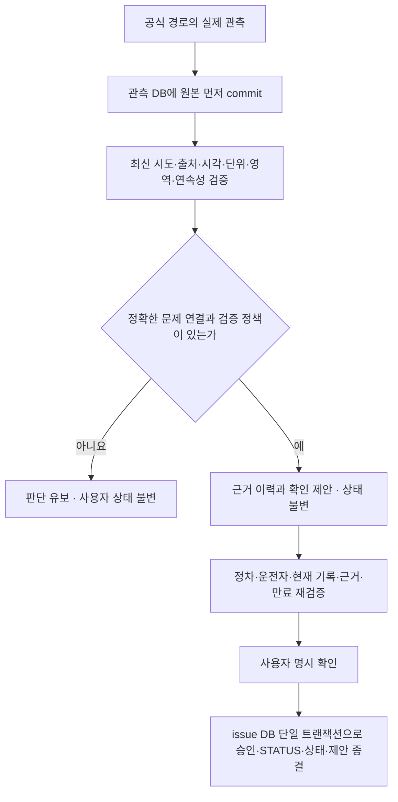

> 2026-11-08 후속 구현: [가상 주행 PoC](CARITDA_VIRTUAL_DRIVING_AI_POC.md)에서 실제 SOC 변화 callback과 사용자 low 안내/조건 해제 sidecar를 검증했습니다. 아래의 고장 회복·사용자 상태 제안/승인·푸시·AI 실제 연결은 여전히 후속 또는 미검증입니다. SOC 증가를 수리 완료로 판정하지 않습니다.

> 이전 단계 상태 기록: 단발 자동 조회·불변 스냅샷 카드·증상 선택 연결은 실제 구현/에뮬레이터 검증했습니다. [자동 기록 P0 검증](AUTOMATIC_RECORDING_ACCEPTANCE.md)을 참고하세요. 당시 아래 회복 판정/상태 제안·승인·low SOC/알림 엔진은 후속 설계였습니다.

# 차량 관측과 사용자 상태 변경의 후속 설계

2026-11-08, Asia/Seoul. 기준 main `aee62bf2548470ee11bfd1e5154639e2ce79e1e5`.

Aside의 [회복·상태 자동화 연구](research/CARITDA_RECOVERY_STATUS_AUTOMATION_RESEARCH.md)와 [탐색·Gleo 연구](research/CARITDA_NAVIGATION_RECORD_GLEO_UX.md)를 읽고 현재 v3 모델에 대응한 후속 설계입니다. **이 문서의 모델·규칙·승인 경로는 구현되지 않았습니다.** 이번 앱은 홈/검색 UX를 개선하며 새 SDK API·권한·DB 열·자동 회복 알림을 추가하지 않습니다.

## 현재 구현과 판단의 한계

현재는 수동 문제·조치·재발·읽음·상태 이력과 SDK 단발 조회입니다. SOC와 주행거리 변화는 소음/진동/고장 회복을 입증하지 않습니다. 연료 미지원은 0%나 정상으로 해석하지 않습니다. 실제 신호를 읽지 않고 경고 소멸·회복 안내를 만들지 않습니다. 자동 상태 변경의 현재 허용 범위는 없습니다.

UNRESOLVED는 미해결, PLANNED는 점검 예정, INSPECTED는 사람이 점검한 기록, RESOLVED는 사람이 해결을 확인한 기록입니다. 관리 중 필터는 앞의 세 상태를 포함하고 완료 필터는 RESOLVED만 포함합니다. 수동 changeStatus는 이전/이후 상태를 본문에, 수행 운전자 snapshot/ID와 시각을 STATUS 이벤트에 남깁니다. 사용자 확인으로 정상 작동한 기능을 결함으로 재분류하지 않습니다.

현재 revision은 수정과 재발 모두에서 증가하며 수동 STATUS에서는 증가하지 않습니다. 이번에는 스키마를 바꾸지 않고 UI에서 ‘내용 버전’과 RECURRENCE 이벤트로 센 ‘재발 횟수’를 구분합니다. 향후 본문 버전/재발 차수 분리가 필요하면 이력 기반 비파괴 이전과 기존 읽음 관계 검증부터 수행합니다. 과거 이벤트의 의미를 임의 재해석하지 않습니다.

## 제안 모델 — v3를 바꾸지 않는 이번 단계의 설계 메모

| 후속 객체 | 필요한 정보 | 보존·권한 경계 |
|---|---|---|
| IssueSignalBinding | issueId/내용 기준 버전, 차량 대응키, kind/area, 의미·확인자, 정책 버전 | 소음에 SOC를 임의 연결하지 않음. 수정/차량 변경 시 재검토 |
| ObservationRef/EvidenceSet | store ID와 불변 행 ID, 최신 시도 참조, source·차량·area·단위·decoder·품질, sourceMeasuredAt/receivedAt/recordedAt, evidenceEpoch | 관측 DB 원본 수정 금지. 환경/앱 UID/차량이 다른 표본을 합치지 않음 |
| RecoveryEvaluation | 평가 ID, issue/binding 버전, 근거 참조, 규칙 버전, 판정/유보 이유, 평가 시각/episode | UNKNOWN/STALE/INSUFFICIENT와 미관측/재등장을 네 사용자 상태와 분리 |
| RecoveryProposal | 현재/제안 상태, 예상 issue state token과 evidenceEpoch, 만료, 근거 fingerprint, pending/accepted/rejected 등 | 생성/조회만으로 상태·읽음·revision을 변경하지 않음 |
| RecoveryEvent sidecar | origin, actorType, 사람의 driverId/snapshot(해당할 때만), reasonCode, evidence/proposal 참조, 전후 값·시각 | SYSTEM을 기존 Driver A/B나 가짜 운전자로 만들지 않음 |

origin 후보는 SIGNAL_OBSERVATION, RULE_PROPOSAL, USER_ACCEPTED_PROPOSAL, USER_MANUAL_CHANGE, POLICY_AUTO_CHANGE입니다. 이는 새로운 SDK enum이나 이미 저장되는 필드가 아닙니다. 현재 events.actor_id는 drivers FK이고 EventKind.valueOf reader를 사용하므로 SYSTEM 문자열을 그냥 넣지 않습니다. 별도 sidecar와 새 reader/이전/롤백 검증 후 연계해야 합니다. 과거 출처 불명 이벤트는 그대로 보존하고 자동 이벤트로 재분류하지 않습니다.

## 후속 데이터 흐름과 원자성

두 SQLite DB를 하나의 자동 원자 트랜잭션으로 취급하지 않습니다. 원관측을 확정한 뒤 issue DB에서 불변 참조를 사용합니다. 모든 관측 writer와 승인 경로가 직렬화 조정기에 참여하고 raw commit→최신 시도/evidenceEpoch 갱신 사이에 오래된 근거의 승인이 끼지 못하게 해야 합니다. issue revision뿐 아니라 현재 상태·삭제·최신 event sequence 또는 새 stateVersion과 근거 epoch/정책/만료를 비교합니다. updatedAt 단독이나 revision 단독은 상태 변경 충돌 토큰으로 충분하지 않습니다.

실패·재시작·다중 writer 때문에 조정 순서를 신뢰할 수 없으면 제안 수락을 잠그고 원본 최신 시도와 pending을 재검증/만료합니다. 이전 실패·비정상 접수가 승인보다 먼저면 승인을 거부합니다. 승인 후 새 관측은 후속 사실로 남기며 과거 관측을 지워 롤백하지 않습니다. 별도 수동 상태 선택은 계속 허용된 기존 사용자 정책으로 처리합니다.

N회·간격·hysteresis·TTL은 신호/차량/정책별로 검증하기 전 비활성입니다. 같은 캐시의 재호출을 독립 표본으로 세지 않고 앱의 10분 오래됨 표시를 회복 판정 TTL로 전용하지 않습니다. receivedAt은 앱 수신 시각이며 ECU 측정 시각으로 바꾸어 설명하지 않습니다. 세션 UUID도 실제 시동/운행 세션의 증거가 아닙니다.

## 추가 데이터·권한의 확인 관문

현재 Manifest의 CAR_ENERGY/CAR_DRIVE와 SDK2.3.2 읽기를 유지합니다. Door와 Window의 대표 조회 권한은 CAR_DOORS/CAR_WINDOWS로 문서에 있지만 개별 함수의 RequiresPermission, Capability access, 지원 area/bounds, 실제 콜백·값·갱신/측정 시각 의미를 확인해야 합니다. 이 권한들은 이번 Manifest에 추가하지 않았습니다. [Pleos 공식 권한 문서](https://document.pleos.ai/docs/pleos-only/connect-sdk-pleos/Vehicle/vehicle-permission).

경고등·실제 타이어 압력은 [공식 샘플의 고정 PublicApiPolicy](https://github.com/Pleos-Playground/pleos-sample-vehicle-app/blob/959981d960ec71144accb27af5ae5d341e72a644/app/src/main/java/ai/pleos/playground/sample/vehicle/explorer/PublicApiPolicy.kt)에서 관련 조회/등록이 차단되어 있음을 다시 확인했습니다. 일반 권한 추가나 비공개 API로 우회하지 않습니다. 저압 임계값과 실제 압력을 혼동하지 않습니다. Door/Window 상태도 수리 완료가 아닙니다.

DTC/OEM 후검증·차종별 진단 근거·정비 확인·타이어 실제 압력·특권 허용은 별도 공식 경로와 실차 검증이 필요합니다. 별도 Vehicle Data HTTP API는 토큰·차량 권한·동의·측정 시각·decoder가 다른 통로이며 SDK 권한만으로 사용할 수 있다고 가정하지 않습니다. 관련 API를 이번에 호출하지 않았습니다.

## Gleo와 안전한 후속 단계

Gleo 음성→앱 Action/Callback 방향, 앱발 독립 상담 요청 미확인, 선택 기록의 로컬 상담 준비라는 세 구분을 유지합니다. 이번에는 기존 로컬 정비 상담 요약만 유지하며 새 AI 상담 버튼·전송·가짜 답변을 만들지 않습니다.

후속 순서는 데이터/권한/Capability/실수신 확인 → 측정·갱신 의미와 문제 연결 검증 → shadow 관찰 → 검증된 근거를 사용한 사용자 확인 제안입니다. 자동 상태 전이는 별도 정책·동의·실차·오탐/미탐·복구 검증 전 활성화하지 않습니다. Aside REC01~REC28은 이후 해당 구현 단계에서 실행해야 하며 이번 UX 테스트를 자동 회복 성공으로 세지 않습니다.
