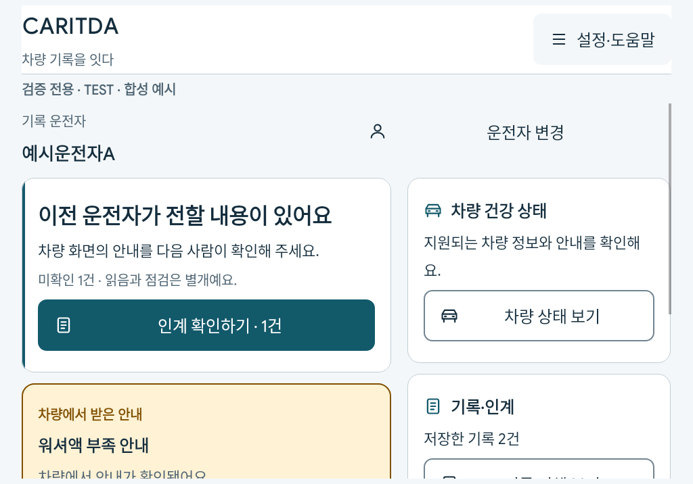
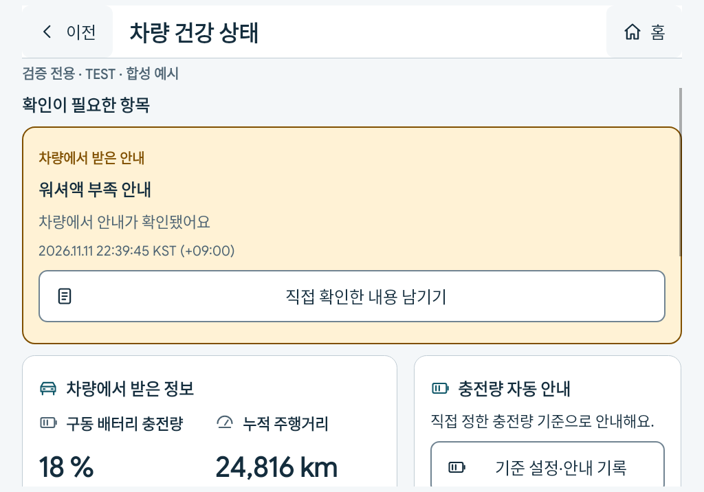
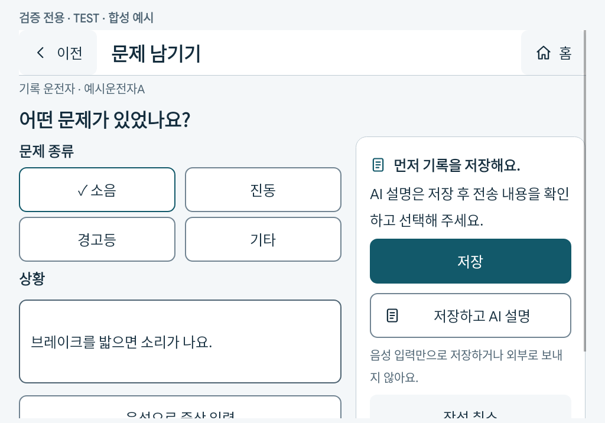
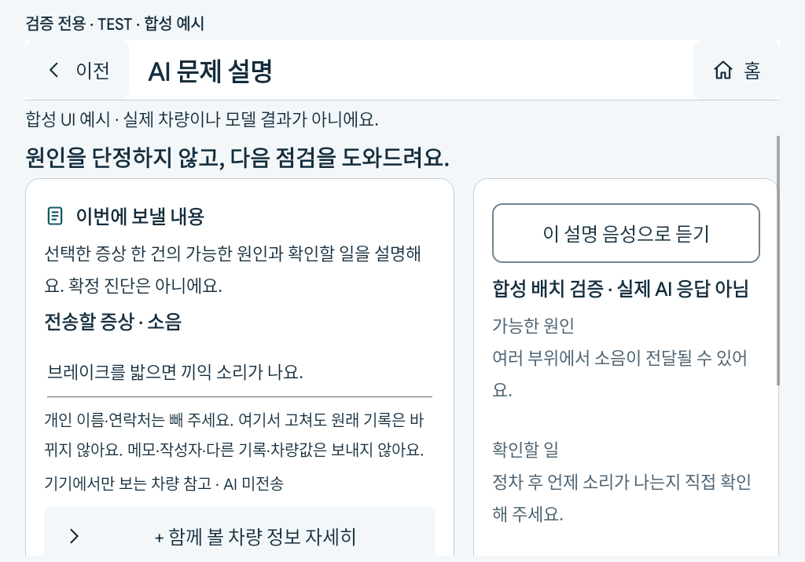

# B안 라이트 · Android 화면 캡처

아래는 Pleos 에뮬레이터에서 실제 Kotlin View를 실행해 얻은 **같은 소스의 validation 앱 렌더 캡처**다. HTML 시안을 제품 화면으로 대체한 이미지가 아니다. 앱 소유 View를 Canvas로 캡처했으며 AI의 FLAG_SECURE를 해제하지 않았다. OS 상태표시줄·공조·Driving View는 앱 캡처 밖이다.

`합성 예시` 표시는 고유 fixture의 운전자·증상·관측·AI 배치용 문장을 뜻한다. 실제 Gemini 응답이나 실차 고장으로 보지 않는다. 별도 SOC18 캡처만 실제 공개 SDK callback의 수신값이다. 시험 이름과 워터마크는 일반 앱에 표시되지 않는다. 일반 앱의 개인 이름이 포함된 캡처는 GitHub에 게시하지 않는다.

| 화면 | 승인 B안 대응 | 실제 연결 |
| --- | --- | --- |
| [홈](assets/b-light/home-light.png) | home | 운전자/미확인 인계/유효 안내/작성·차량·기록 |
| [차량 건강](assets/b-light/vehicle-light.png) | health | 주요 수치·시각, 사용자 안내와 분석 각각 별도 |
| [문제 작성](assets/b-light/record-light.png) | record | 음성·직접 편집·선택 정보·명시 저장/저장AI |
| [기록 목록](assets/b-light/issues-light.png) | records | 검색/네 필터·이전 복원·원본 상태 |
| [기록 상세](assets/b-light/detail-light.png) | detail | 원문·상태·주행동·AI·위치/차량·접힌 관리 |
| [AI 설명](assets/b-light/ai-light.png) | ai | 이번 전송 내용·준비된 결과·전체 음성 듣기; 배치용 합성 문장 |
| [운전자 인계](assets/b-light/handover-light.png) | handover | 미확인 큐, 상세에서 명시 읽음 |
| [설정](assets/b-light/menu-light.png) | settings | 이름 관리·테마·표시·사용법·개인정보 |
| [도움말](assets/b-light/help-light.png) | help | 세 역할·상황별 사용법 |

추가 상태: [확인 항목 0건 홈](assets/b-light/home-empty-light.png), [실제 SDK SOC18 홈](assets/b-light/home-sdk-soc18.png), [다크 홈](assets/b-light/home-dark.png), [다크 차량](assets/b-light/vehicle-dark.png), [320dp·200% 작성](assets/b-light/record-320-large.png).

실제 SDK SOC18은 **사용자 기준20% 미만 안내**이며 배터리 고장 신호가 아니다. 다른 홈의 워셔액 안내는 SDK 형태의 fixture로 상태 UI를 검증한 예다. 이 에뮬레이터의 실제 워셔액 신호는 미지원으로 관측됐으므로 실제 워셔액 이상 수신으로 보고하지 않는다.

원래 Main22개+AI2모드와 새 인계의 전수 대응, 삭제·이동한 행동의 새 경로는 [화면별 비교표](B_LIGHT_UI_SCREEN_MATRIX.md)에 있다. 원본 B HTML은 해시를 대조한 뒤 외부 통신이 차단된 Android WebView에서9페이지를 렌더해 비교했다. Android의76dp·큰 글씨/짧은 창·실제 동의/안전 안내·정상 수치 홈 제외를 우선했으므로 시안과 픽셀 단위 동일성을 주장하지 않는다.

일반 앱의 전체9화면 사람 조작·고령자/초보자 이해도·물리 접근성·실차는 별도 미검증이다. 자동 배치 검사만으로 사용자 경험의 최종 수용을 완료 처리하지 않는다. 실제 설치·검사 수치·데이터 보존·남은 확인은 [인수 기록](B_LIGHT_UI_ACCEPTANCE.md)에 구분한다.
